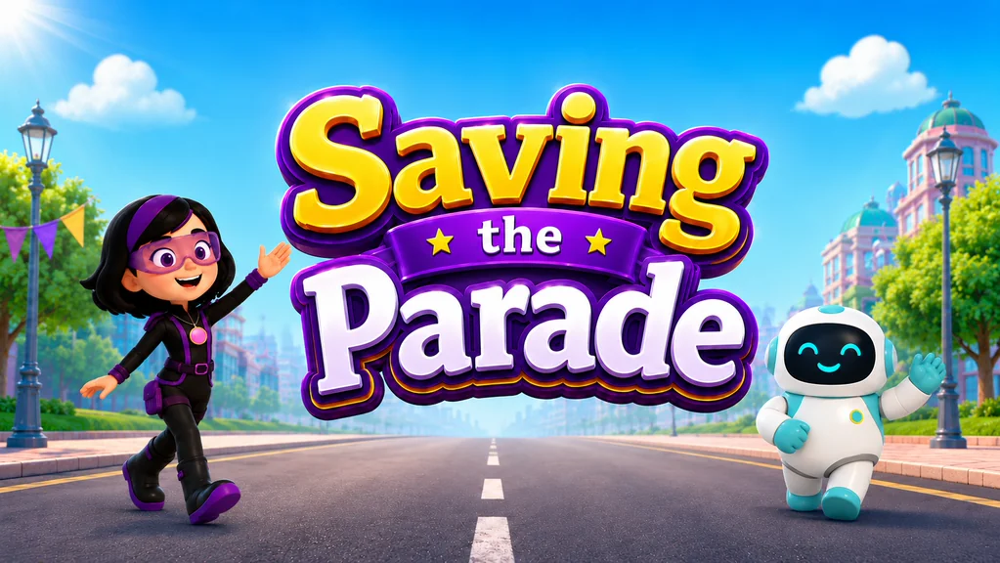

<div align="center">

# 🎉 Saving the Parade

**A 3D storybook that turns like a real hardcover, with the PowerUp Bots equal-parts game bound in after page three.**

[](https://saving-the-parade.vercel.app)




</div>

## About

**Saving the Parade** is an interactive picture book for young learners in the lower primary grades. The story plays out as video pages inside a 3D book. After page three the book opens into a full-screen mini game, **PowerUp Bots**. Learners aim a laser to cut an energy block into four equal parts and fit each part into a bot's charging slot, so they practise splitting a whole into equal shares. The whole thing is a plain static site: no framework and no build step.

## Highlights

- **A real 3D hardcover.** The book has thickness, a spine and a floor shadow. The cover swings open on its hinge, and the pages curl as they turn by tap, drag, swipe or arrow keys.
- **Paced story pages.** The forward arrow stays hidden until the page's video has finished. If a clip fails, an error or watchdog fallback reveals it anyway. A page you have already watched stays unlocked, and on a revisit its video starts again from the beginning.
- **A game bound into the book.** PowerUp Bots loads quietly in the background, then grows from the page into a full-screen overlay. It has voice-over narration, a tutorial, an idle hand hint and four rounds (square, rectangle, triangle, circle). If the parts don't fit, the learner gets a Try Again prompt.
- **The game must be finished to move on.** No arrow, key or swipe can skip the game page. When the bots are charged, a Next button appears over the win screen and takes the reader back to the story.
- **Fast first load.** A themed progress bar fills while the cover art and posters download, and Play appears at 100%. Later videos and the game warm up while the reader is busy.
- **Lean media.** Videos are WebM, audio is Ogg/Opus and images are WebP. The repo's own measurements show the deployed payload dropping from about 64 MB to about 22 MB.
- **Tablet ready.** On touch devices a rotate prompt keeps the book in landscape. The controls scale with the smaller side of the screen and keep a touch target of at least 44 px. On desktop, Play also enters fullscreen.
- **Sound.** There are page-flip and cover-open effects, plus the game's theme track as soft background music. The music pauses while the game plays its own copy.

## How to play

1. Wait for the loader to fill, then tap **Play** on the cover. The book opens.
2. Watch each story page. When the clip ends, the **Next** arrow appears in the bottom-right corner.
3. After page three, the PowerUp Bots game opens full screen. Tap **Let's Go** and listen to the bots.
4. Turn the laser with the **left / right** buttons, then tap **Cut**. Make two cuts so the block splits into four equal parts.
5. When every part fits a slot, the bots charge up. Clear all four rounds, then tap **Next** to go back to the story.
6. On **THE END** page, tap **Replay** to close the book and start again.

## Tech stack

- **HTML5, CSS3 and vanilla JavaScript.** CSS 3D transforms drive the book, cover hinge and page curl.
- **An embedded game.** It is a single-file HTML5 game in an `<iframe>`, connected to the book through a small `postMessage` bridge (`game/embed-bridge.js`).
- **Web Audio and HTML5 audio/video.** Sound effects are inlined as base64 in `sfx-data.js`, and the pages use WebM video with posters.
- **Fullscreen API and Fetch streams.** The streams give the byte-accurate preloader (`preload.js` and `asset-manifest.json`).
- **Dev tooling only (never deployed).** This covers Node.js scripts, an FFmpeg-based media converter and a [Playwright](https://playwright.dev) test suite.

## Run locally

```bash
git clone https://github.com/aniketchauhan-star/saving-the-parade.git
cd saving-the-parade

# Option 1: any static server
npx serve .

# Option 2: the bundled dev server (no install needed, supports video seeking)
node dev/server.mjs        # then open http://127.0.0.1:8137/
```

To run the Playwright tests (optional):

```bash
cd dev
npm install
npx playwright install chromium
npx playwright test        # starts dev/server.mjs on port 8137 automatically
```

## Project structure

```text
saving-the-parade/
├── index.html               # Book markup: 3D cover, Play button, loader, game overlay
├── script.js                # Flip engine, page list, video gating, game overlay logic
├── styles.css               # Book, cover, controls and animation styles
├── preload.js               # Two-stage preloader (gates Play, warms later pages)
├── asset-manifest.json      # Generated asset list with real byte sizes
├── sfx-data.js              # Inlined page-flip sound effects for Web Audio
├── assets/                  # Story videos (WebM), page posters, cover and Play art
├── sfx/                     # Page-flip and cover-open sounds
├── game/                    # PowerUp Bots game as embedded in the book
├── LBD 1/story/             # Standalone game source with debug tools (not deployed)
├── dev/                     # Dev server, media and manifest scripts, Playwright tests
└── IMPLEMENTATION_REPORT.md # Notes on the media, loading and gating work
```

`.vercelignore` keeps `dev/`, `LBD 1/` and the report out of the deployed site.

## Further reading

- [IMPLEMENTATION_REPORT.md](IMPLEMENTATION_REPORT.md) covers the media conversion results, the preload design, video gating, the game handshake and test coverage.

## Credits

- Design & development: **Aniket Chauhan**, UI/UX Designer & Developer
- **Karan** ([Karan26-web](https://github.com/Karan26-web)): fixed the black flash on tablets when Play is tapped, along with the fullscreen handling. He also worked on the game's start handshake and embedded boot screen, and added Playwright checks for the opening transition and loading.
